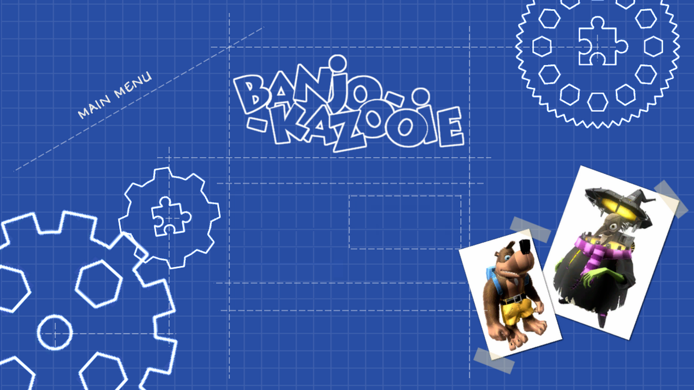

# NutStaller

A launcher and installer for [reNut](https://github.com/masterspike52/reNut), the PC recompilation of
Banjo-Kazooie: Nuts & Bolts.



## What it does

- Downloads the latest reNut release and the latest extract-xiso build
- Extracts your Banjo-Kazooie: Nuts & Bolts (US) ISO with live progress
- Writes `renut.cfg` so the in-game path wizard never shows up
- Keyboard and mouse setup for reNut: every bind (keys and mouse buttons), mouse look, sensitivity and invert Y, saved to `renut.toml`
- Checks for reNut updates
- Workshop: browse community vehicle blueprints and reNut part mods in a grid, download them (a vehicle brings the part mods it needs) or remove them again, and share your own (through [nutstaller-workshop](https://github.com/etonedemid/nutstaller-workshop))
- Works with mouse or a gamepad (dpad moves, A selects, LB/RB switch page, Start plays)
- Runs on Windows and Linux (on Linux it installs the reNut AppImage; gamepad support uses SDL2 if installed)

## Usage

1. Run `NutStaller.exe` (Windows) or `NutStaller-x86_64.AppImage` (Linux)
2. Pick an install folder
3. Hit "Do everything" and select your ISO when asked
4. Hit "Play"

Drop an ISO into the install folder beforehand and step 3 picks it up automatically.

## Building

```
dotnet publish -p:PublishProfile=win-x64
dotnet publish -p:PublishProfile=linux-x64
```

Each produces a single self-contained executable under `bin/publish/<rid>/`. Requires the .NET 8 SDK
or newer. The UI is Avalonia, so either build can be made from any OS.

For Linux, `./build-appimage.sh` packages it as `NutStaller/bin/NutStaller-x86_64.AppImage`.
On Linux the launcher keeps `nutstaller.ini` and its default `reNut` folder next to the AppImage.

### Linux compatibility

The launcher itself needs glibc 2.17 or newer (no .NET, ICU or SDL needed on the host; SDL2 only
enables gamepad support). Tested on Ubuntu 20.04 and 24.04. What it downloads has its own floor:
the extract-xiso Linux build needs glibc 2.34 and the reNut AppImage needs glibc 2.38
(Ubuntu 24.04, Debian 13, Fedora 39 or newer). If reNut quits right after Play, the launcher says
so and shows the system's glibc version.

## Credits

reNut by masterspike52 and contributors. extract-xiso by the XboxDev team.
Banjo-Kazooie: Nuts & Bolts by Rare. See the Credits page in the app for the full list.
